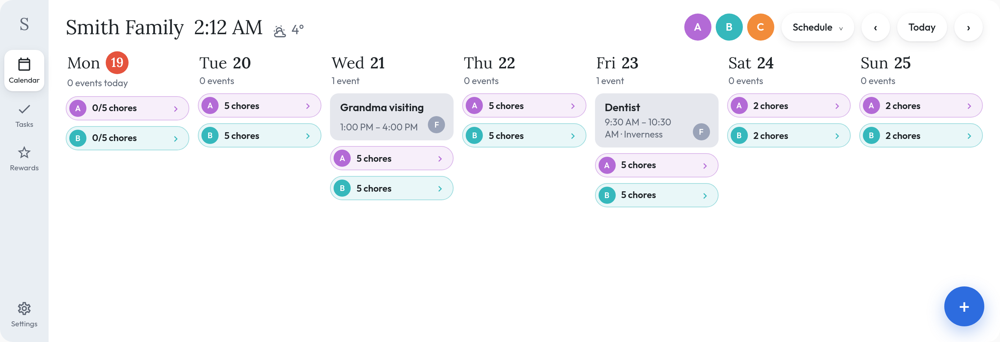
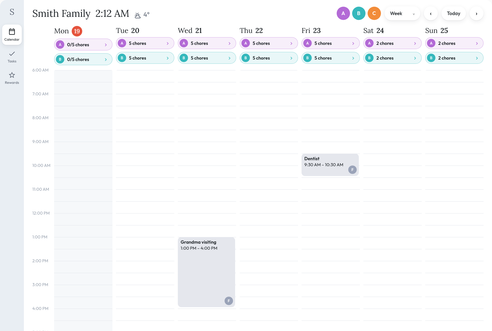
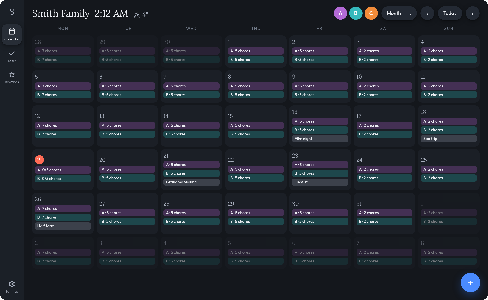
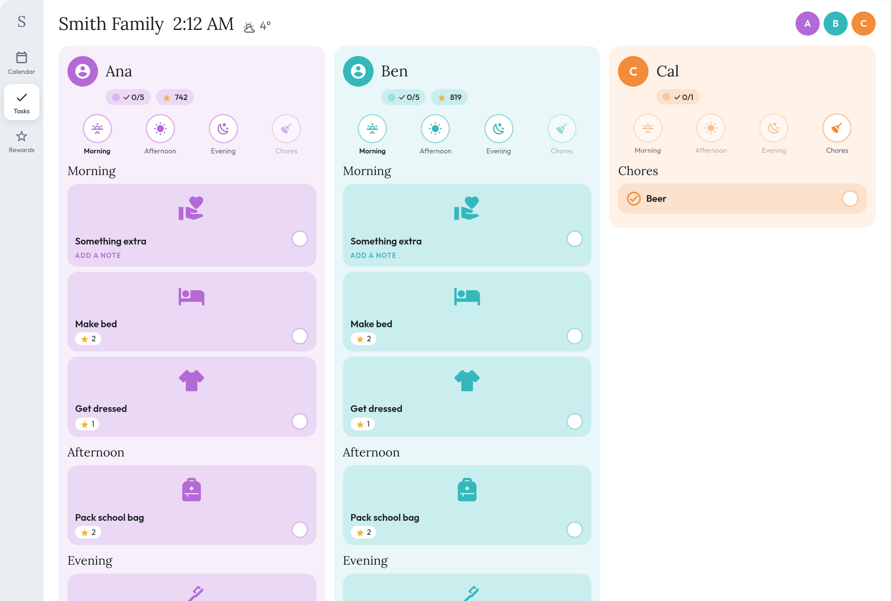
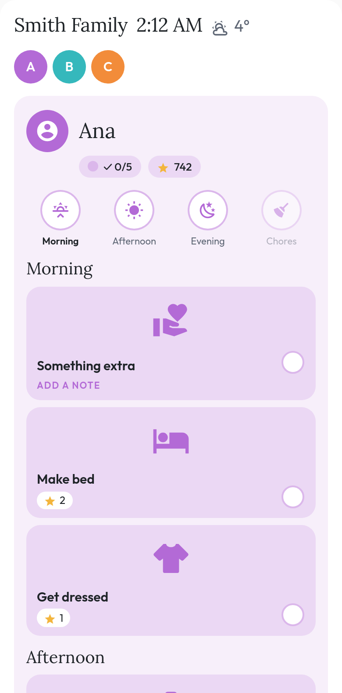

<h1 align="center">Family Hub Card</h1>

<p align="center">
  <strong>Everyone's day on one screen, and the chores nobody can claim they forgot.</strong><br>
  A Home Assistant Lovelace card for the wall tablet in your kitchen.
</p>

<p align="center">
  <a href="https://github.com/hacs/default"></a>
  <a href="https://github.com/tempus2016/family-hub-card/blob/main/LICENSE"></a>
  
  <a href="https://github.com/tempus2016/family-hub-card/releases"></a>
  <a href="https://github.com/tempus2016/family-hub-card/releases"></a>
</p>

<p align="center">
  <a href="https://github.com/tempus2016/family-hub-card/actions/workflows/validate.yml"></a>
  <a href="https://github.com/tempus2016/family-hub-card/actions/workflows/tests.yml"></a>
</p>

---

A Home Assistant Lovelace card that turns a wall-mounted tablet into a
Skylight-style family hub: one card, a rail of screens, a serif-and-sans look
with a pastel tint per person, and everything tappable at child height.

Works with any `calendar.*` and `todo.*` entities. No cloud, no account.
[TaskMate](https://github.com/tempus2016/taskmate) is supported as an enhanced
backend for points, approvals, icons and rewards.



### Calendar

Four views behind one picker. **Schedule** is seven columns of stacked event
cards, each in its owner's tint with a small avatar, and a tick box on any
event that is also a chore. **Week** is a timed grid with an hour gutter and
cards sized by duration. **Month** is six weeks of chips; tap a day to open it.
**Day** is one day's cards with a now-line. A shared family calendar shows once
in a neutral colour, and a meals calendar shows as a pill at the top of each
day. Tap an event for its full time, location and description.





### Tasks

One tinted column per person: avatar, name, a progress pill and a stars pill,
four rings for Morning, Afternoon, Evening and Chores, then hero tiles with the
chore's icon, name, stars and a round tick. Done tiles go a stronger tint.

TaskMate chores that need more than a tick open a sheet instead: a stepper for
a count ("How many pages?"), a text box for an open-ended chore, the tablet's
camera for a photo chore, or a photo and a note together. The sheet submits
through TaskMate's own `complete_chore`, so approval rules apply as usual.
Timed chores open TaskMate's stopwatch: Start, Pause, Resume and Finish, with
the points earned so far. The timer runs in TaskMate, so it keeps going while
the tablet sleeps and shows on the tile as "running · 4:12".
This works for children who are not linked to their own Home Assistant
account, the same rule TaskMate's kiosk card follows.



On a phone the rail becomes a bottom bar and the columns stack:



### Rewards

TaskMate's catalogue for each child, with their balance against every cost.
Redeem asks for a second tap, then files a claim for a parent to approve.

### Settings

Theme (follows Home Assistant on `auto`), home screen, calendar view and
hide-completed, stored per device so the wall tablet can stay dark and open on
Tasks while your phone does something else.

The card follows the Home Assistant profile for language (English and
Portuguese) and 12- or 24-hour time. Avatars come from the person's photo,
a picture URL, or TaskMate's avatar. Fonts are Lora and Outfit (SIL OFL),
embedded in the bundle.

## Install

HACS → Frontend → custom repository `tempus2016/family-hub-card`, category
Lovelace. Then add the resource if your instance does not do it automatically —
type **JavaScript Module**, not JavaScript file.

Full instructions, including manual install: [Installation](https://github.com/tempus2016/family-hub-card/wiki/Installation).

## Configuration

```yaml
type: custom:family-hub-card
family_name: Smith Family
home: calendar
calendar_view: schedule
theme: auto
refresh_interval: 300
chore_filter: today
confirm_window: 3
header:
  clock: true
  weather: weather.home
  subtitle: sensor.bin_collection
shared_calendars: [calendar.family]
meals_calendar: calendar.meals
taskmate_chores: sensor.taskmate_chores
taskmate_rewards: sensor.taskmate_rewards
people:
  - name: Ana
    color: "#4A9EFF"
    calendars: [calendar.ana_work]
    todo: todo.ana_chores
    person: person.ana
```

| Option | Default | Notes |
|---|---|---|
| `theme` | `auto` | `auto` follows Home Assistant's dark mode. `dark` or `light` pins it — useful for a wall tablet |
| `family_name` | — | Header title. Shows today's date when empty |
| `home` | `calendar` | Screen the card opens on and returns to: `calendar`, `tasks`, `rewards` |
| `calendar_view` | `schedule` | `schedule`, `week`, `month` or `day`. (Legacy `view:` still works: agenda→day, columns→schedule) |
| `return_to_today` | `120` | Seconds idle before the card snaps back to the home screen and today. `0` disables |
| `refresh_interval` | `300` | Seconds; minimum 60. One HTTP call per calendar per refresh |
| `chore_filter` | `today` | `today` = overdue, due today and undated. `all` = everything |
| `inline_chores` | `true` | Put a tick box on a calendar event that matches a chore. `false` keeps the calendar plain |
| `hide_completed` | `false` | Hide done tiles on the Tasks screen by default |
| `confirm_window` | `3` | Seconds to undo a tick before it is sent. `0` completes immediately |
| `week_start` | `monday` | `monday`, `sunday`, or `today` for a rolling seven days |
| `max_completed` | `3` | How many completed items from a stock to-do list stay visible, struck through. `0` hides them |
| `shared_calendars` | — | Calendars for the whole family. Shown once as a neutral "Family" row; `shared_name` and `shared_color` rename and recolour it |
| `taskmate_chores` | — | TaskMate's chores sensor: completed-today rows, approval state, chore icons, stars and which chores need a note, photo or count |
| `taskmate_rewards` | — | TaskMate's rewards sensor. Adds the Rewards screen |
| `meals_calendar` | — | A calendar whose events show as a meal pill at the top of each day |
| `people[].points` | — | A points sensor, shown as a balance beside the person, with their streak when TaskMate reports one |
| `people[].person` | — | A `person.*` entity whose photo becomes the avatar |
| `people[].picture` | — | A picture URL for the avatar, overriding everything else |

Overdue chores are marked in red.

Each person needs `calendars`, `todo`, or both. Every option, including the
per-person keys and the validation rules:
[Configuration](https://github.com/tempus2016/family-hub-card/wiki/Configuration).

## Chores

Chores come from one `todo.*` list per person. Any to-do list works — Home
Assistant's built-in Local To-do, Google Tasks, or anything else exposing a
`todo` entity.

[TaskMate](https://github.com/tempus2016/taskmate) is supported as an enhanced
backend: it already exposes one to-do list per child, so point `todo:` at it and
optionally add `points:` to show balances. Set `taskmate_chores:` to also show
what has been completed today, including chores waiting on a parent's approval.

Note that completed-today rows need **both** `points:` and `taskmate_chores:` —
the card matches completions to a person using the `child_id` attribute on the
points sensor. See
[TaskMate Integration](https://github.com/tempus2016/family-hub-card/wiki/TaskMate-Integration).

## Development

```bash
npm install
npm test          # vitest
npm run lint      # eslint
npm run build     # rollup → dist/family-hub-card.js
python3 scripts/build-fonts.py   # only after changing assets/fonts/
```

`dist/family-hub-card.js` is committed because HACS serves it straight from the
repo, so **run `npm run build` and commit the result whenever you change
`src/`** — CI fails the build if the committed bundle doesn't match a fresh one.

Verified against a local Home Assistant instance at tablet and phone widths.

See [CONTRIBUTING.md](.github/CONTRIBUTING.md) before opening a PR, and
[Development](https://github.com/tempus2016/family-hub-card/wiki/Development)
for the design constraints behind the code.

## Links

- [Documentation wiki](https://github.com/tempus2016/family-hub-card/wiki)
- [Report a bug or request a feature](https://github.com/tempus2016/family-hub-card/issues/new/choose)
- [Discussions](https://github.com/tempus2016/family-hub-card/discussions)
- [Security policy](.github/SECURITY.md)
- [Code of Conduct](CODE_OF_CONDUCT.md)

## Licence

[MIT](LICENSE)
